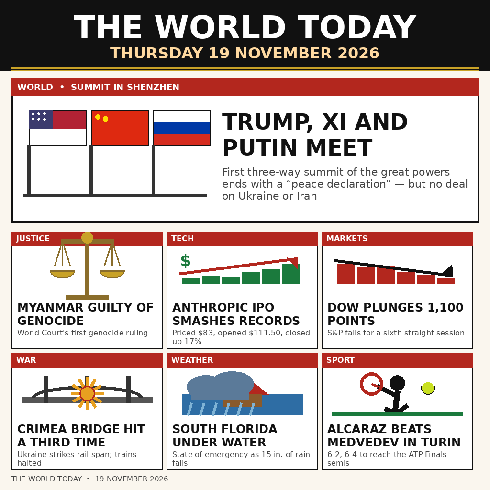

# The World Today — Thursday 19 November 2026

[](https://make.fun/c/news-image-20261119)
[](https://make.fun/c/news-image-20261119)
[](https://make.fun/c/news-image-20261119)

One front page that sums up **Thursday 19 November 2026** in a single image:
the first-ever three-way Trump–Xi–Putin summit in Shenzhen, the World
Court's genocide ruling against Myanmar, Anthropic's record-breaking IPO,
a 1,100-point Dow plunge, the third strike on the Crimea Bridge that week,
historic flooding in South Florida, and Alcaraz's win over Medvedev at the
ATP Finals in Turin.



## How it was made

`gen_image.py` draws the whole front page from scratch with Pillow —
masthead, flags, charts, scales, bridge, flood and tennis illustrations are
all flat vector-style shapes, no photos and no downloaded assets. The
generator is deterministic: two runs produce byte-identical output.

`main.py` is standard-library only: it simply copies the committed
`entry.png` to `$MAKEFUN_OUTPUT_DIR/entry.png`, so it runs in the grader's
sandbox with no Pillow and no network.

## Run

```sh
python3 gen_image.py 3 entry.png   # regenerate the image (variant 3)
MAKEFUN_OUTPUT_DIR=out python3 main.py
```

## License

MIT — see [LICENSE](LICENSE).
